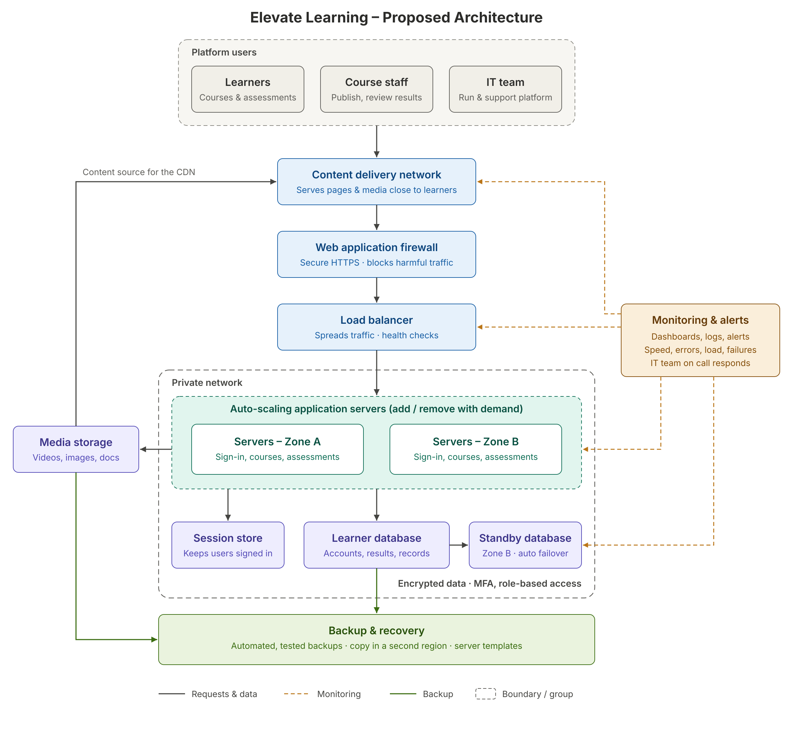

# Cloud Architecture Case Study — Scaling a Learning Platform for Launch

A solutions-architecture exercise: take a growing online learning platform that is
struggling under load, and design a scalable, reliable, secure and cost-conscious
AWS architecture that can absorb a major product launch without disrupting existing
users.

The client ("Elevate Learning") and brief are fictional. I worked through this via
the AWS Forage job simulation and then wrote it up as my own case study, mapping each
decision to concrete AWS services and a phased rollout.

---

## The problem

Elevate Learning serves 80,000+ learners and expects at least 30,000 more within a
year of launching a new professional-development programme in three months. The
current platform:

- runs on a small number of **fixed-capacity servers** that slow down and drop
  requests at peak sign-in (course launches, enrolment deadlines, assessments);
- serves **video from the same servers** as the application, so media competes with
  sign-in and assessments for resources;
- stores all learner records in **one database** with a slow, manual recovery process;
- has **limited monitoring**, so the team hears about problems from learners first;
- carries **fixed infrastructure cost** even in quiet periods.

Constraints: limited first-phase budget, a three-month deadline, and minimal
disruption to existing learners.

## The architecture

Learners reach the platform through a CDN that serves media from separate storage.
Application traffic passes a firewall and a load balancer to auto-scaling servers in
two availability zones, backed by a managed database with a standby replica.
Monitoring watches every tier; backups cover the data and media.

### How each decision maps to AWS

| Problem in the current platform | Design decision | AWS service |
| --- | --- | --- |
| Fixed capacity, manual prep for spikes | Auto-scaling application tier | EC2 Auto Scaling group |
| One server takes all traffic | Load balancing across 2 AZs | Application Load Balancer, multi-AZ |
| Video competes with the app | Separate media storage + CDN | S3 + CloudFront |
| Users logged out when servers scale | Shared session store | ElastiCache (or token-based sessions) |
| Single database, manual recovery | Managed DB with standby + backups | RDS Multi-AZ, automated backups |
| Learner data at risk | Identity, access, encryption, firewall | IAM, KMS, security groups, AWS WAF |
| Problems found only when users report | Monitoring and alerting | CloudWatch metrics, alarms, dashboards |
| Cost fixed even when idle | Pay for what's used + guardrails | Auto Scaling + AWS Budgets |

## Key design decisions

- **Sessions must be externalised.** Auto-scaling adds and removes servers, so a
  session tied to one server logs the learner out when that server is retired. A
  shared session store keeps them signed in through scaling events — the detail most
  "just add auto-scaling" answers miss.
- **The database is the next bottleneck.** A standby replica protects against failure
  but does not add read capacity. Sign-ins, course access and assessment submissions
  still hit one primary, so read replicas or caching are planned for the growth phase.
- **Cost has to stay predictable.** Auto-scaling makes the bill move with demand, so
  the scaling group has a hard maximum and budget alerts give the client a ceiling.

## Phased rollout (budget- and deadline-aware)

The full architecture can't be built at once on a limited budget three months before
launch, so it's sequenced by risk:

1. **Prepare for launch** — monitoring, auto-scaling + load balancer + session store,
   media to S3/CloudFront, tested backups, MFA and HTTPS. Everything that prevents a
   launch-day failure, mostly usage-priced.
2. **Strengthen the platform** — migrate to the managed database (the riskiest change,
   so after launch), web application firewall and private networking, runbooks and
   recovery drills, cost tuning on real traffic data.
3. **Support growth** — multi-region delivery, read replicas, cross-region DR, and an
   automated deployment pipeline.

The current database and servers are retained temporarily as a fallback during the
transition, and traffic is shifted gradually (10% → 50% → 100%) with the option to
roll back.

Full phased plan: [phased-implementation-plan.md](phased-implementation-plan.md)

## Key trade-offs

- **Keep the current database through launch** — avoids a high-risk migration before
  the deadline, at the cost of leaving a single point of failure in place (mitigated
  by tested backups, monitoring and a load test).
- **Run old and new servers in parallel** — instant rollback, at the cost of paying
  for both environments for a few weeks.
- **Defer the firewall and private network to phase 2** — keeps phase 1 in budget,
  with MFA, HTTPS and failed-sign-in monitoring covering the gap meanwhile.

## What I practised here

Translating a business brief into technical requirements; choosing AWS services
against scalability, reliability, security, performance and cost; and sequencing a
migration so it's realistic for a real budget and deadline rather than a greenfield
ideal.

---

*Author: Mubarak Makuyi · AWS Cloud Practitioner, working toward Solutions Architect
Associate (SAA-C03).*
